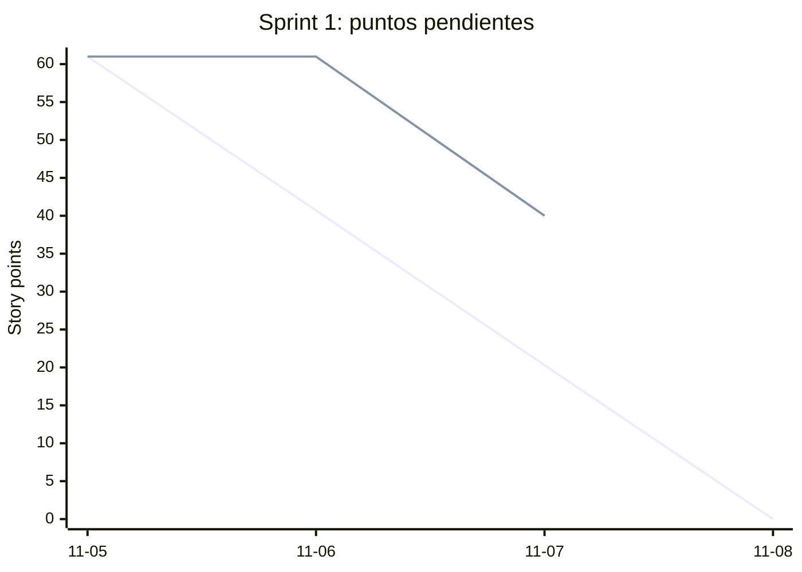

# Burndown — Sprint 1 (2026-11-05 → 2026-11-08)

Generado con `docs/agil/metricas/burndown.sh` a partir del tablero de GitHub Projects. Datos en [`sprint-1.csv`](sprint-1.csv).

Línea de arriba al inicio: **ideal** (baja lineal hasta 0). Segunda línea: **real** (puntos de historias que no están en *Done*).

| Fecha | Pendientes | Hechas | Abiertas |
|---|---|---|---|
| 2026-11-05 | 61 / 61 | 0 | 14 |
| 2026-11-06 | 61 / 61 | 0 | 14 |
| 2026-11-07 | 40 / 61 | 4 | 10 |
