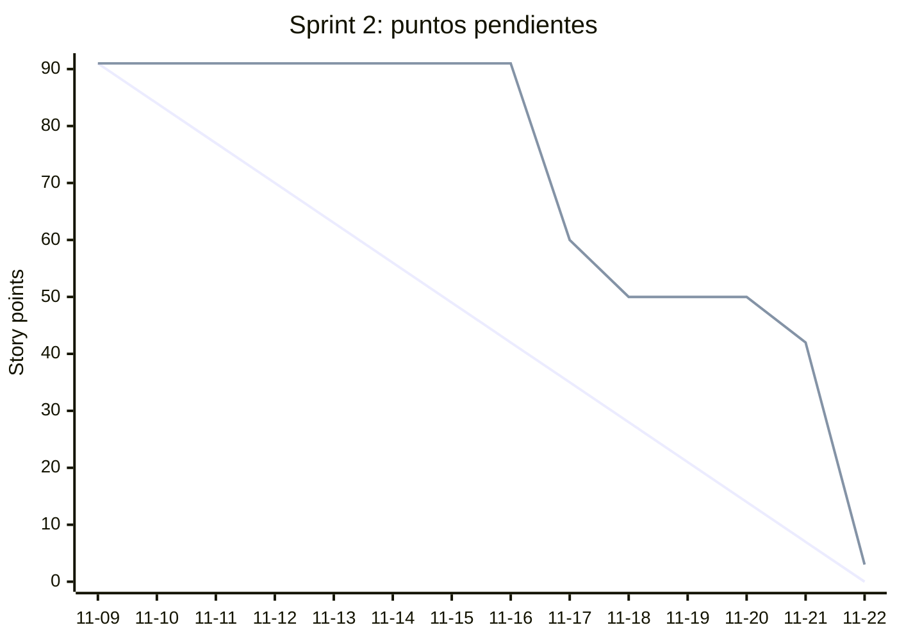

# Burndown — Sprint 2 (2026-11-09 → 2026-11-22)

Generado con `docs/agil/metricas/burndown.sh` a partir del tablero de GitHub Projects. Datos en [`sprint-2.csv`](sprint-2.csv).

> **Nota sobre los datos.** Del 9 al 18 de noviembre no se tomó la foto diaria: el Sprint 2 empezó a trabajarse el 13 y las fotos no se agendaron (lección de la retro). Esas filas se **reconstruyeron** al cierre de cada día con la fecha real de cierre (`closedAt`) de cada issue en GitHub, en hora de Colombia. A partir del 19 las toma `burndown.sh` desde el tablero.

Línea de arriba al inicio: **ideal** (baja lineal hasta 0). Segunda línea: **real** (puntos de historias que no están en *Done*).

| Fecha | Pendientes | Hechas | Abiertas |
|---|---|---|---|
| 2026-11-09 | 91 / 91 | 0 | 15 |
| 2026-11-10 | 91 / 91 | 0 | 15 |
| 2026-11-11 | 91 / 91 | 0 | 15 |
| 2026-11-12 | 91 / 91 | 0 | 15 |
| 2026-11-13 | 91 / 91 | 0 | 15 |
| 2026-11-14 | 91 / 91 | 0 | 15 |
| 2026-11-15 | 91 / 91 | 0 | 15 |
| 2026-11-16 | 91 / 91 | 0 | 15 |
| 2026-11-17 | 60 / 91 | 3 | 12 |
| 2026-11-18 | 50 / 91 | 6 | 9 |
| 2026-11-19 | 50 / 91 | 6 | 9 |
| 2026-11-21 | 42 / 91 | 7 | 8 |
| 2026-11-22 | 3 / 91 | 14 | 1 |
