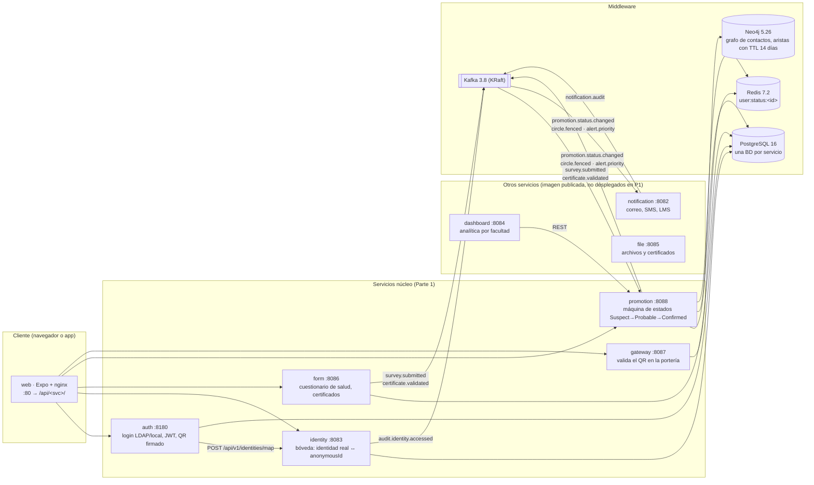
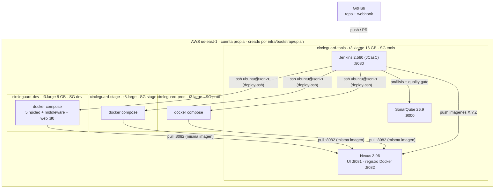
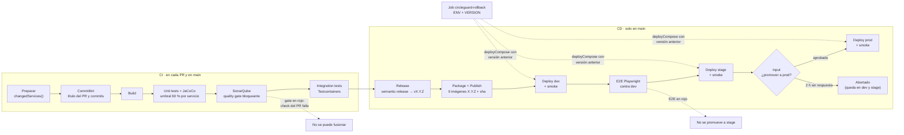

# Arquitectura de CircleGuard y del pipeline (HU-12, #19)

Diagramas en Mermaid (GitHub los dibuja). Fuente de verdad: el código; si algo cambia, se actualiza aquí en el mismo PR.

## 1. Servicios, eventos y datos

8 servicios Spring Boot 3.2.4 (Java 21) y un cliente web (Expo exportado a estáticos y servido por nginx, que además es el *reverse proxy* `/api/<servicio>/...`). En la Parte 1 se despliegan los **5 servicios núcleo** más el web; dashboard, file y notification tienen imagen publicada pero no se despliegan (memoria de las VMs de 8 GB).

**Flujo principal que prueban las pruebas de integración y los E2E:**

1. El usuario inicia sesión en **auth** (`super_admin`/`password` en local). auth pide a **identity** el `anonymousId` y firma un JWT; con él emite un **QR firmado** (HS256, vence a los 5 min).
2. El usuario responde el cuestionario en **form**, que publica `survey.submitted`.
3. **promotion** consume el evento: si hay síntomas, pasa al usuario a `SUSPECT` en Neo4j, propaga a sus contactos (`SUSPECT` → `PROBABLE` → `CONFIRMED`), escribe `user:status:<anonymousId>` en Redis y publica `promotion.status.changed`.
4. El guardia valida el QR en **gateway**: verifica la firma y consulta Redis. `SUSPECT`, `PROBABLE` o `CONFIRMED` → `RED` (acceso negado); lo demás → `GREEN`.
5. **notification** consume `promotion.status.changed` y despacha el aviso (correo/SMS) y la asistencia remota en el LMS.

La identidad real solo vive en la bóveda de identity (cifrada con `VAULT_SECRET`); el grafo y Redis solo conocen el `anonymousId`.

## 2. Ambientes e infraestructura (Parte 1)

- Cada ambiente es una VM, un *security group* y una IP elástica propios. SSH a los ambientes solo desde las IPs del equipo y desde el SG de tools; el registro de Nexus solo desde los SG de los ambientes; el puerto 80 de cada ambiente es público.
- Los secretos de cada ambiente se generan **en su VM** la primera vez que se despliega (`deploy.sh`) y nunca pasan por el repo ni por Jenkins.
- Apagar y encender: `infra/bootstrap/down.sh` / `up.sh` (idempotente). Ver [`infra/bootstrap/README.md`](../../infra/bootstrap/README.md).

## 3. Pipeline (CI en cada PR, CD en `main`)

| Pieza | Dónde |
|---|---|
| Pipeline declarativo | [`Jenkinsfile`](../../Jenkinsfile) |
| Shared Library (pasos reutilizables) | [`jenkins/vars/`](../../jenkins/vars) · `changedServices`, `commitLint`, `runGradle`, `sonarScan`, `dockerPublish`, `semanticRelease`, `deployCompose`, `smokeTest`, `e2eTests`, `releaseHistory`, `notifyTeam` |
| Job de rollback | [`jenkins/rollback.Jenkinsfile`](../../jenkins/rollback.Jenkinsfile), creado por JCasC |
| Jenkins como código | [`infra/tools/jenkins/casc/jenkins.yaml`](../../infra/tools/jenkins/casc/jenkins.yaml) (credenciales, librería, Sonar, jobs) |
| Versionado | [`.releaserc.json`](../../.releaserc.json) · [`docs/release-notes/`](../release-notes/README.md) |
| Compose por ambiente | [`deploy/compose/`](../../deploy/compose/README.md) |
| Avisos | [`jenkins/vars/notifyTeam.groovy`](../../jenkins/vars/notifyTeam.groovy) → Discord y WhatsApp (CallMeBot) en fallo, espera de aprobación, éxito y rollback |

**Ejecución selectiva:** en un PR solo se construyen y analizan los servicios cuyos archivos cambiaron (un cambio en Gradle, `Jenkinsfile` o `jenkins/` construye todos). En `main` la CI sigue siendo selectiva, pero la publicación es siempre de las 9 imágenes con la misma versión, porque el compose de cada ambiente usa un solo `IMAGE_TAG`.
