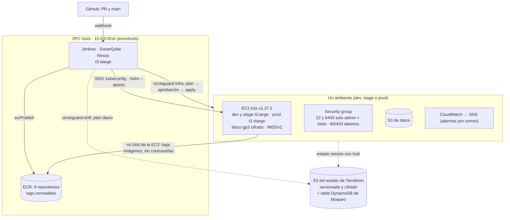
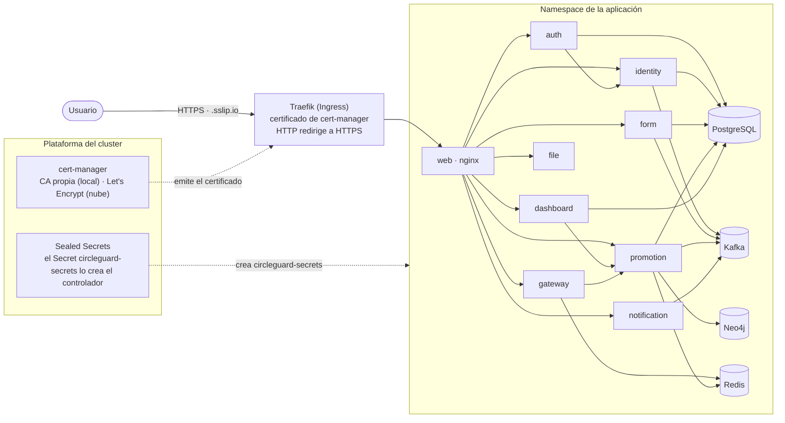

# Arquitectura desplegada de la Parte 2 (HU-26, E2.9)

Dos vistas de lo que se despliega: **la nube** (qué crea Terraform y cómo se conecta Jenkins) y **un cluster** (qué corre dentro de cada ambiente). El diagrama de Terraform con sus módulos está en [`infra-terraform.md`](infra-terraform.md); el pipeline, en [`pipeline-k8s.md`](pipeline-k8s.md); la seguridad, en [`seguridad.md`](seguridad.md).

## 1. La nube: cuatro estados de Terraform y un estado compartido

- **Una VPC por ambiente** (dev `10.10.0.0/16`, stage `10.20.0.0/16`, prod `10.30.0.0/16`; cada una con su propio estado de Terraform), una subred pública, sin NAT Gateway (≈ USD 32/mes cada uno): el aislamiento lo da la red propia y los grupos de seguridad. Un fallo o una prueba de caos en `dev` no toca `prod`.
- **Un solo nodo por ambiente** (k3s): es Kubernetes certificado y cabe en el presupuesto; EKS habría costado ≈ USD 216/mes solo en planos de control (ver [`costos.md`](../operaciones/costos.md)).
- Antes del *cutover* (importar las 4 IP elásticas y destruir las VMs de Bash), Jenkins sigue en la VM de la Parte 1 y `envs/tools` solo aporta los repositorios ECR (`TARGET=module.registry`).

## 2. Dentro de un cluster (un ambiente)

- El namespace se llama `circleguard-<ambiente>` y su **NetworkPolicy cierra toda la entrada salvo la tabla `networkPolicy.allow`**.
- Cada servicio corre **sin root, con disco de solo lectura, seccomp y sin token de la API de Kubernetes**; el middleware es la excepción documentada (imágenes oficiales que arrancan como root).
- Sondas `startup`, `liveness` y `readiness` contra `/actuator/health/...`, y HPA por CPU (70 %). En `dev` y `stage` (8 GB) `dashboard`, `file` y `notification` están apagados; `prod` corre los 8.
- La tabla de qué servicio puede llamar a cuál, y por qué `promotion/internal` solo la alcanzan la web, el dashboard y el gateway, está en [`seguridad.md`](seguridad.md#quién-puede-llamar-a-quién).

## 3. Dónde está cada cosa

| Tema | Documento | Código |
|---|---|---|
| Terraform: módulos, ambientes, estado remoto | [`infra-terraform.md`](infra-terraform.md), [`infra/terraform/README.md`](../../infra/terraform/README.md) | `infra/terraform/` |
| Kubernetes: chart, probes, HPA, Ingress | [`deploy/helm/README.md`](../../deploy/helm/README.md) | `deploy/helm/` |
| Pipeline, Trivy, despliegue y drift | [`pipeline-k8s.md`](pipeline-k8s.md) | `Jenkinsfile`, `jenkins/` |
| Seguridad (red, pods, secretos, TLS, RBAC) | [`seguridad.md`](seguridad.md) | `security/`, `deploy/helm/platform/` |
| Patrones de diseño | [`docs/patrones/`](../patrones/README.md) | `services/` |
| Costos y manual de operaciones | [`costos.md`](../operaciones/costos.md), [`manual-operaciones.md`](../operaciones/manual-operaciones.md) | |
