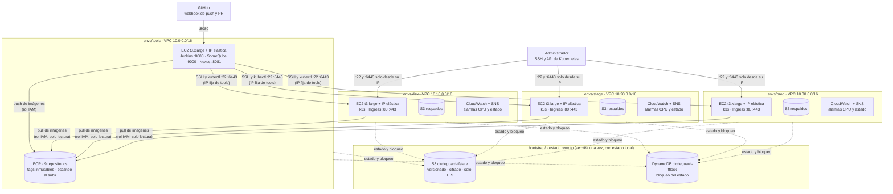

# Infraestructura de la Parte 2 con Terraform (HU-14, #21)

Diagrama de lo que declara [`infra/terraform/`](../../infra/terraform/README.md). Mermaid (GitHub lo dibuja). Fuente de verdad: el código; si algo cambia, se actualiza aquí en el mismo PR.

## 1. Vista general

Cada ambiente es una carpeta con su propio estado (`envs/<ambiente>/terraform.tfstate`) y llama a los mismos módulos con otras variables. Nada comparte red con otro ambiente: lo que se rompa en dev no toca prod.

## 2. Módulos

| Módulo | Crea | Se reutiliza en |
|---|---|---|
| `network` | VPC, subred pública, internet gateway, tabla de rutas, security group con una regla por puerto y origen | tools, dev, stage, prod |
| `compute` | IP elástica, rol IAM y perfil, VM Ubuntu 24.04 con **IMDSv2 obligatorio** y disco gp3 **cifrado**; `role = k3s` instala k3s y `role = tools` deja la VM lista para el bootstrap | tools, dev, stage, prod |
| `registry` | Un repositorio ECR por imagen, tags **inmutables**, escaneo al subir, limpieza de imágenes viejas | tools |
| `storage` | Bucket S3 con versionado, cifrado, acceso público bloqueado, solo TLS y expiración de versiones antiguas | dev, stage, prod |
| `observability` | Tema SNS con correo, alarma de CPU (> 80 %), alarma de chequeo de estado y grupo de logs con retención de 14 días | tools, dev, stage, prod |

## 3. Qué se abre a la red

| Ambiente | Puerto | Origen | Para qué |
|---|---|---|---|
| tools | 22 | IP del administrador | SSH |
| tools | 8080, 9000, 8081 | cualquiera | Jenkins (webhook de GitHub y docente), SonarQube y Nexus, todos con login |
| dev, stage, prod | 22 y 6443 | IP del administrador y la IP fija de tools | SSH y API de Kubernetes (Jenkins despliega desde tools) |
| dev, stage, prod | 80 y 443 | cualquiera | Ingress de la aplicación |

El SSH nunca se abre a `0.0.0.0/0`; una prueba del módulo `network` lo comprueba.

## 4. Decisiones y por qué

| Decisión | Por qué | Alternativa descartada |
|---|---|---|
| **k3s en una EC2 por ambiente** | Kubernetes certificado y ligero. Cada ambiente queda aislado y encaja con «tres ambientes parametrizados» | EKS: el control plane cuesta USD 0,10/h **por cluster** (3 clusters = +70 % del gasto del proyecto) |
| **Infraestructura nueva con Terraform**, no importar la de Bash | El estado es la única fuente de verdad y el `plan` sale limpio sin importar atributos uno por uno | Importar las VMs de la Parte 1 (frágil) o mantener las dos plataformas (el doble de costo) |
| **Sin NAT Gateway**, nodos con IP pública | Un NAT cuesta unos USD 0,045/h (~USD 33 al mes cada uno) | Subredes privadas con NAT: más aislamiento, 65 % del presupuesto mensual solo en NAT |
| **ECR** como registro | Se integra con IAM (sin contraseñas en los nodos), tags inmutables y escaneo al subir | Seguir con Nexus: HTTP sin TLS y credenciales en cada nodo |
| **Estado en S3 con DynamoDB y `use_lockfile`** | El criterio pide S3 + DynamoDB; HashiCorp marcó el bloqueo con DynamoDB como obsoleto, y `use_lockfile` lo deja válido cuando lo retiren | Solo uno de los dos |
| **Terraform y herramientas en Docker con versiones fijas** | Mismas versiones para el equipo y para Jenkins; nada que instalar | Instalar los binarios en cada PC |
| **Terraform provisiona, Bash configura el software** | `bootstrap-tools.sh` ya instala Jenkins, SonarQube y Nexus de forma idempotente; solo cambia de dónde saca las IP (`write-hosts-env.sh`) | Reescribirlo todo como `user_data` |

## 5. Cómo se verificó

Lo mismo que se pide en la rúbrica P2.2, con su evidencia en [`docs/evidencias/sprint-2/hu-14-terraform.md`](../evidencias/sprint-2/hu-14-terraform.md): `fmt`, `validate`, 22 pruebas de módulos, `tflint` y Trivy sin hallazgos HIGH ni CRITICAL, y una prueba real en AWS de los cuatro ambientes con `plan` limpio después del `apply`.
