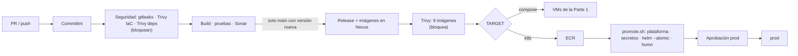

# Pipeline que gobierna Terraform, la seguridad y Kubernetes (HU-16, E2.3)

Cómo Jenkins controla la infraestructura y el despliegue en Kubernetes, qué se probó y qué falta por probar. Evidencia con las salidas reales: [`hu-16-pipeline.md`](../evidencias/sprint-2/hu-16-pipeline.md).

## Qué hace cada job

| Job | Qué gobierna | Cuándo corre | Aprobación |
|---|---|---|---|
| **`circleguard`** (multibranch, el de siempre) | CI de cada PR y, en `main`, versión → imágenes → Trivy → dev → stage → prod | PR, merge a `main` | prod (`input`, como en la Parte 1) |
| **`circleguard-infra`** | `terraform plan` y `apply`/`destroy` de **un** ambiente | a mano, con parámetros `ENV`, `ACTION`, `TARGET` | prod y cualquier `destroy` |
| **`circleguard-drift`** | `terraform plan` de cada ambiente **desplegado**, para detectar cambios hechos a mano | cada día (cron) | ninguna: no cambia nada |
| **`circleguard-k8s`** | despliega (o devuelve) una **versión ya publicada** en un ambiente de Kubernetes: ECR → kubeconfig → `promote.sh`. Sirve para levantar un ambiente recién creado y para volver a una versión anterior | a mano, con `ENV` y `VERSION` | prod |
| `circleguard-rollback` | volver dev/stage/prod (compose) a una versión anterior | a mano | prod |

## Etapas que bloquean (E2.3: «Trivy bloqueante»)

Corren en **cada** build, también en los PR, con `./security/run.sh` (Docker, versiones fijas):

1. **Secretos (gitleaks)** sobre lo que git versionaría (`secrets-tree`).
2. **Trivy: IaC** sobre los Dockerfile, el chart de Helm renderizado y Terraform (`iac`).
3. **Trivy: dependencias** sobre los `package-lock.json` (`deps`).
4. **Trivy: imágenes**, solo en `main` con versión nueva, sobre las 9 imágenes recién publicadas (`image`). Si falla, ningún ambiente recibe la versión.

HIGH y CRITICAL bloquean (en imágenes y dependencias, solo con arreglo publicado). Las excepciones están revisadas **por CVE y con vencimiento** en `.trivyignore.yaml`; un CVE nuevo vuelve a bloquear. Detalle y deuda aceptada: [`seguridad.md`](seguridad.md).

## Kubernetes: `TARGET=k8s`

El parámetro `TARGET` del job `circleguard` elige el destino de dev, stage y prod. **Por defecto es `compose`** (las VMs de la Parte 1): los webhooks y los reescaneos no cambian nada. Con `k8s`, `deployK8s` hace en cada ambiente:

1. **ECR**: copia las 9 imágenes desde Nexus a ECR (los nodos las bajan con el rol IAM de su EC2, sin contraseñas). Los tags son inmutables: si ya están, se omiten.
2. **kubeconfig**: pregunta a Terraform la IP del nodo (`terraform output`) y lee `/etc/rancher/k3s/k3s.yaml` por SSH con la credencial `deploy-ssh`. Si el ambiente no existe, falla diciendo que corra `circleguard-infra`.
3. [`deploy/helm/promote.sh`](../../deploy/helm/promote.sh), el mismo script que se corre a mano:
   - `platform.sh ensure`: instala cert-manager y Sealed Secrets y sella los secretos **solo si faltan** (cluster nuevo); en uno que ya los tiene no toca nada.
   - `release.sh deploy`: `helm upgrade --install --atomic`; si los pods no quedan listos, Helm revierte solo. El motivo, el commit y el build quedan en el historial.
   - `smoke.sh`: sondas de los 5 servicios núcleo, que `/version` diga la versión pedida y un **login real** por `https://<ip-con-guiones>.sslip.io`.
   - `release.sh history --md`: el registro de cambios del ambiente se **archiva con el build** (`history-<ambiente>.md`).

Dev → stage → aprobación → prod es el mismo flujo de la Parte 1 (`input` con `submitter` de los dos integrantes); lo único que cambia es el paso de despliegue. Las notificaciones (Discord y WhatsApp) no se tocaron: avisan fallos, la espera de aprobación y el resultado.

## Terraform: `circleguard-infra` y `circleguard-drift`

- **`circleguard-infra`**: `fmt` + `validate` de todo el código, Trivy IaC, `plan -out=tfplan` (se archiva `plan-<ambiente>.txt`), **aprobación** (prod y `destroy`) y `apply` **del mismo `tfplan`** que se revisó: si algo cambió entre el plan y el apply, Terraform se niega. Se aplica de a un ambiente por el límite de 5 IP elásticas de la cuenta. `TARGET` permite, por ejemplo, crear solo `module.registry` en `tools` (los repositorios ECR) sin levantar su VM.
- **`circleguard-drift`**: para cada ambiente mira si tiene recursos en el estado; si no, lo omite (sin recursos no hay nada que comparar). Si tiene, `plan -detailed-exitcode -lock=false`: código 2 deja el build **INESTABLE** y avisa. Si no puede leer el estado (credenciales o backend rotos) falla en rojo: **no se confunde «no pude leer» con «no hay nada»**.

## Cómo se ejecutan las herramientas dentro de Jenkins

Jenkins corre en un contenedor con el socket de Docker del host. Un `docker run -v "$PWD:/work"` desde ahí le pasa al host una ruta que solo existe dentro del contenedor, y Docker monta una carpeta **vacía**: la herramienta no ve el código (y puede dar un «verde» falso). [`scripts/hostpath.sh`](../../scripts/hostpath.sh) traduce cada ruta con los montajes del propio contenedor; fuera de un contenedor devuelve la ruta tal cual, y si una ruta no está en un volumen **falla en voz alta**. Lo usan `infra/terraform/run.sh`, `deploy/helm/run.sh`, `deploy/helm/platform.sh` y `security/run.sh`, así que **los mismos scripts sirven en el portátil y en Jenkins**.

## Qué necesita Jenkins (nada de esto se versiona)

| Variable / credencial | Para qué | De dónde sale |
|---|---|---|
| credencial `aws-terraform` | Terraform y ECR | `AWS_ACCESS_KEY_ID` / `AWS_SECRET_ACCESS_KEY` al correr `up.sh` (un usuario de IAM **propio** de Jenkins, no el de administración) |
| `TF_STATE_BUCKET` | backend remoto de Terraform | `infra/terraform/backend.hcl` del que corre `up.sh` |
| `TF_VAR_admin_cidrs`, `TF_VAR_tools_cidr`, `TF_VAR_ssh_public_key`, `TF_VAR_alert_email` | lo que antes era `terraform.tfvars` | IP pública de quien corre `up.sh`, IP de la VM tools, llave pública de `deploy-ssh`, `ALERT_EMAIL` |
| `ECR_REGISTRY`, `ACME_EMAIL` | destino de las imágenes y correo de Let's Encrypt | cuenta de AWS y `ALERT_EMAIL` |

Todas tienen valor por defecto vacío en el JCasC: **un Jenkins sin ellas arranca igual que antes** y los jobs nuevos fallan diciendo qué falta.

## Qué se probó y qué no

| | Cómo | Estado |
|---|---|---|
| Las herramientas corren dentro del contenedor de Jenkins | un «Jenkins» simulado (contenedor con el socket del host y un volumen `jenkins_home`) corre `helm check`, `secrets-tree`, `iac`, `deps`, `selftest` y `terraform fmt/validate`; el código anterior **falla** ahí (control) | **probado** |
| `promote.sh` completo | contra un k3s real local (cluster nuevo): plataforma, secretos sellados, `--atomic`, humo con login, historial; y una segunda corrida sin tocar lo ya instalado | ver la evidencia |
| `terraform state list` con el backend por variables | contra el estado real de S3 (solo lectura): 0 recursos en los ambientes destruidos | **probado** |
| Sintaxis de los Jenkinsfile y de la biblioteca | `groovyc`; YAML del JCasC | **probado** (no es lo mismo que el linter de Jenkins) |
| Los jobs y las etapas dentro de **Jenkins real** | — | **sin probar**: necesita una ventana de Jenkins |
| `terraform apply`, kubeconfig por SSH, ECR y Let's Encrypt en AWS | — | **sin probar**: necesita una ventana de nube |
| La aprobación a prod con el rol de Desarrollador | — | **sin probar** |

**Riesgos conocidos.** Los escaneos nuevos corren en todos los builds: si la red de la VM no baja la base de datos de Trivy, bloquean también los PR (la primera vez baja ~3 GB). Cambiar `Jenkinsfile` o `jenkins/` hace que la CI construya los 8 servicios. Trivy escanea las imágenes **después** de publicarlas en Nexus: bloquea la promoción, no la publicación.

## Ejecución real en AWS (22 y 23 de nov de 2026)

Los jobs `circleguard-infra`, `circleguard-k8s` y `circleguard-drift` se ejecutaron por primera vez contra AWS con un usuario de IAM propio de Jenkins (`circleguard-jenkins`, permisos acotados). Resultado, con la duración de cada etapa: [`hu-16-aws-jenkins-jobs.md`](../evidencias/sprint-2/hu-16-aws-jenkins-jobs.md). Estado del cluster: [`hu-16-aws-dev-estado.txt`](../evidencias/sprint-2/hu-16-aws-dev-estado.txt); rollback: [`hu-25-aws-rollback.txt`](../evidencias/sprint-2/hu-25-aws-rollback.txt); TLS válido de Let's Encrypt: [`hu-23-aws-tls.txt`](../evidencias/sprint-2/hu-23-aws-tls.txt).

Lo que apareció solo al ejecutar de verdad, y su arreglo:

| Hallazgo | Arreglo |
|---|---|
| Con `TARGET` vacío el job de Terraform fallaba (`T_TARGET: unbound variable`) | `jenkins/infra.Jenkinsfile` usa `${T_TARGET:-}` |
| Los pods no bajaban imágenes de ECR (`no basic auth credentials`): containerd no usa el rol IAM de la VM | El `user_data` del nodo k3s instala un temporizador que renueva el token de ECR en `registries.yaml` cada 6 h. Probado con `terraform test`; **falta validarlo en un nodo real** |
| El primer despliegue pasa los 10 min de Helm (descarga de imágenes y arranque de JVM en 2 vCPU) | `--atomic` revirtió solo; el segundo intento, con las imágenes ya en el nodo, tardó 6 min. Para un cluster nuevo conviene `HELM_TIMEOUT=20m` |
| Un correo de alarmas inválido rompe el `plan` | Se configura `ALERT_EMAIL` en `secrets.env` antes de encender Jenkins |

Sin probar en AWS: el pipeline principal con `TARGET=k8s`, los ambientes stage y prod, y la observabilidad (solo existe en Compose).
