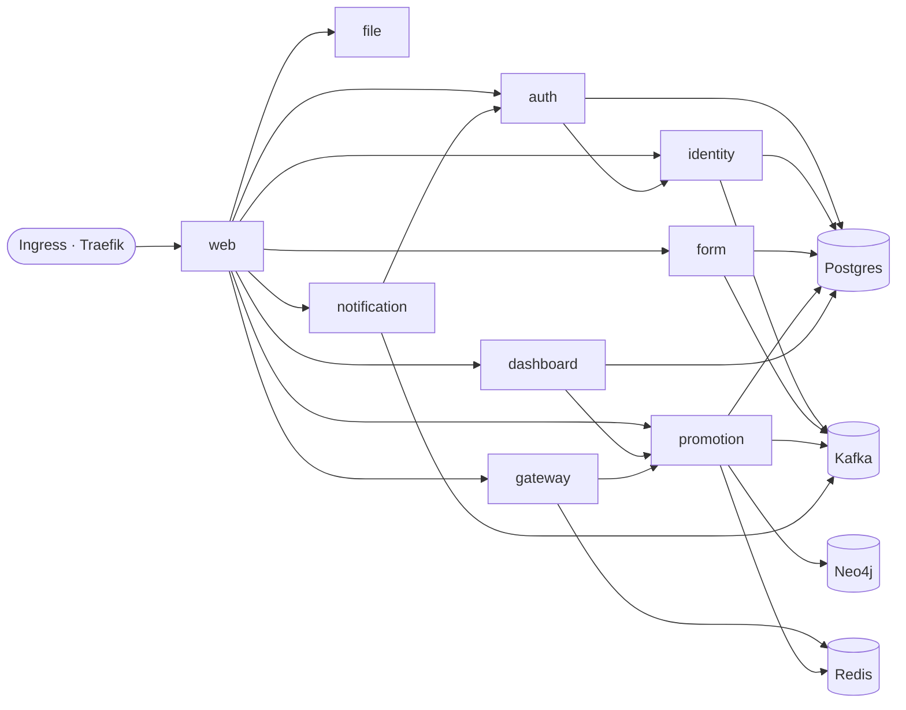

# Seguridad de la plataforma (HU-23, E2.6)

Qué protege cada capa, cómo se comprueba y qué riesgos se aceptaron. Evidencia con las salidas reales: [`hu-23-seguridad.md`](../evidencias/sprint-2/hu-23-seguridad.md).

| Capa | Qué se hizo | Dónde | Cómo se comprueba |
|---|---|---|---|
| Secretos en el repositorio | gitleaks sobre todo el historial y sobre lo que git versionaría; las excepciones están revisadas una por una | [`security/run.sh`](../../security/run.sh), [`.gitleaks.toml`](../../.gitleaks.toml) | `./security/run.sh check` (con control negativo) |
| Secretos en el cluster | **Sealed Secrets**: los secretos se generan al azar, se sellan con la llave pública del cluster y solo el controlador los abre | [`platform.sh`](../../deploy/helm/platform.sh), chart (`existingSecret`) | el archivo sellado solo tiene datos cifrados; el Secret lo crea el controlador |
| Red | **NetworkPolicies**: todo el tráfico de entrada se rechaza salvo la tabla `networkPolicy.allow` | [`networkpolicy.yaml`](../../deploy/helm/circleguard/templates/networkpolicy.yaml) | 73 pruebas del chart y `local.sh security-smoke` en un k3s real |
| Pods | sin root, usuario numérico de la imagen, seccomp por defecto, disco de solo lectura, sin capacidades | [`deployment.yaml`](../../deploy/helm/circleguard/templates/deployment.yaml) | Trivy (KSV-0014 y KSV-0118) y el mismo `security-smoke` |
| RBAC en Kubernetes | ServiceAccount de los pods **sin permisos ni token**; rol de solo lectura sin Secrets para operar y para el docente | [`rbac.yaml`](../../deploy/helm/circleguard/templates/rbac.yaml) | `kubectl auth can-i` (`security-smoke`) |
| RBAC en Jenkins | tres niveles: administrador, desarrollador (lanza y aprueba, no administra) y lectura (docente); el anónimo no tiene nada | [`jenkins.yaml`](../../infra/tools/jenkins/casc/jenkins.yaml) | se aplica al reiniciar Jenkins; se comprueba en la ventana de HU-16 |
| TLS | **cert-manager** emite el certificado del Ingress, Traefik atiende solo HTTPS y redirige el HTTP | [`ingress.yaml`](../../deploy/helm/circleguard/templates/ingress.yaml), [`platform/`](../../deploy/helm/platform) | `local.sh tls-smoke` (verifica contra la CA, rechaza sin ella) |
| Escaneo continuo | **Trivy**: IaC (Dockerfile, chart, Terraform), dependencias npm e imágenes; HIGH/CRITICAL bloquea | [`security/run.sh`](../../security/run.sh), [`.trivyignore.yaml`](../../.trivyignore.yaml) | `./security/run.sh check` e `image` |

## Quién puede llamar a quién

La red nace cerrada: `default-deny-ingress` rechaza toda entrada y cada flecha de abajo es una regla `allow-to-<destino>`. La tabla sale de las URLs entre servicios de los `application.yml` y de las dependencias que cada servicio espera al arrancar; si un servicio nuevo llama a otro, se agrega a `networkPolicy.allow` o la llamada se rechaza.

**La ruta interna de promotion.** `/internal/v1/users/{id}/status` (la usa el gateway para el cache-aside) no tiene autenticación. Tiene dos defensas: el nginx de la web responde 404 a `/api/<servicio>/internal/` desde fuera, y la NetworkPolicy deja llegar a promotion **solo a web, dashboard y gateway**. `auth`, `form`, `identity` y el resto no pueden ni conectarse (se probó con HTTP real: el gateway recibe respuesta; `auth` se queda sin respuesta). **Límite:** una NetworkPolicy filtra por pod y puerto, no por ruta HTTP; `dashboard` y `web` sí podrían llamar a `/internal` si quisieran. Cerrarlo del todo exige autenticación entre servicios (un token o mTLS), que cambia el código y queda fuera de este alcance.

## Los pods

Cada servicio corre sin root con el usuario de su imagen (`100` en las Spring, `101` en nginx), con el perfil seccomp por defecto, sin escalar privilegios, sin capacidades y con el disco de solo lectura. Lo que necesita escribir va en volúmenes efímeros: `/tmp` en todos, `/etc/nginx/conf.d` en la web (nginx genera ahí su configuración al arrancar) y `/app/uploads` en el servicio de archivos. Ningún pod monta el token de la API de Kubernetes: si alguien entra a un contenedor, no puede leer Secrets ni tocar el cluster desde ahí.

**Excepción documentada: el middleware.** Postgres, Kafka, Neo4j y Redis usan imágenes oficiales que arrancan como root para ajustar la propiedad del volumen `local-path` (es `hostPath`, y kubelet no le aplica `fsGroup`) y luego bajan privilegios ellas mismas, además de escribir fuera de sus volúmenes. Con el disco de solo lectura no arrancan. Quedan con `KSV-0014` y `KSV-0118` aceptados en [`.trivyignore.yaml`](../../.trivyignore.yaml), con vencimiento (31 ene 2027) para obligar a revisarlos. Lo que las acota: NetworkPolicy (solo sus clientes llegan), sin token de la API, `allowPrivilegeEscalation: false` donde la imagen lo admite. La salida real es usar volúmenes CSI con `fsGroup` y correr con el usuario de la imagen.

## Secretos

- **Repositorio:** ningún secreto real. [`values-secrets.example.yaml`](../../deploy/helm/circleguard/values-secrets.example.yaml) solo trae `CAMBIAR`; gitleaks bloquea un hallazgo nuevo (control negativo incluido). El historial no se reescribió (decisión documentada en [`security/README.md`](../../security/README.md)).
- **Cluster:** `platform.sh seal <ambiente>` genera los secretos con `openssl rand`, arma el `Secret` y lo cifra con la llave pública del controlador sin escribir el texto plano en disco. El `SealedSecret` resultante **es seguro de versionar**, pero solo el cluster que lo selló puede abrirlo. El chart se despliega con `--set existingSecret=circleguard-secrets`. Si el Secret ya existe no se regenera (cambiaría la contraseña de una base ya inicializada).
- **Costo de efímero:** cada cluster nuevo tiene su propia llave, así que un `SealedSecret` no sobrevive a un `terraform destroy`; se vuelve a sellar en cada ventana de nube.

## TLS

cert-manager `v1.21.1` con dos tipos de emisor ([`deploy/helm/platform`](../../deploy/helm/platform)):

- **`circleguard-ca`** (local y pruebas): un emisor autofirmado crea un certificado raíz y de él cuelga el emisor que firma los certificados del Ingress. Se confía en esa CA importándola. **Por eso un navegador lo marca como no confiable: es esperado y se justifica porque es un cluster local sin dominio público.**
- **`letsencrypt`** y **`letsencrypt-staging`** (nube): ACME por HTTP-01 a través de Traefik; el host es `<ip-con-guiones>.sslip.io`, que resuelve a la IP pública del nodo. Se instalan pasando un correo: `platform.sh install <correo>`. Falta probarlos con un dominio real: **necesita una ventana de nube** (puerto 80 abierto al mundo), que hoy no está autorizada.

El Ingress con TLS solo escucha en HTTPS y un segundo Ingress redirige el HTTP. Con TLS activo, la NetworkPolicy deja pasar a Traefik hasta el pod temporal que resuelve el desafío de Let's Encrypt.

## Escaneo continuo con Trivy (umbral bloqueante)

| Escaneo | Qué mira | Bloquea | Línea base |
|---|---|---|---|
| `iac` | Dockerfile, chart de Helm **renderizado** y Terraform | HIGH y CRITICAL | 0 (middleware aceptado con vencimiento) |
| `deps` | `package-lock.json` de la web y de las pruebas E2E | HIGH y CRITICAL con arreglo | 74 hallazgos de la cadena de compilación de Expo aceptados |
| `image` | las 9 imágenes (8 servicios y la web) | HIGH y CRITICAL con arreglo | 0 en el sistema operativo; 74 CVE de Java aceptados |

- **El chart se renderiza antes de escanearlo.** Sin eso Trivy lo salta sin avisar y sale en verde: la primera corrida dio 0 hallazgos y, al renderizarlo, **44 HIGH**. El runner exige que el resumen nombre el chart, los Dockerfile y Terraform.
- **Solo bloquea lo que tiene arreglo (`--ignore-unfixed`)** en imágenes y dependencias: un hallazgo sin corrección publicada no se puede resolver.
- **Cada excepción lleva motivo y fecha de vencimiento** y se acota por CVE; un CVE nuevo, aunque sea del mismo paquete, vuelve a bloquear.
- **La web:** de 68 hallazgos a 0 subiendo la base a `nginx 1.30` y con `apk upgrade`.
- **Java: la deuda real.** Los 74 CVE de las librerías vienen de **Spring Boot 3.2.4** y lo que arrastra (Spring Framework 6.1, Spring Security 6.2, Tomcat 10.1.19, Jackson 2.15), una línea sin soporte abierto. El arreglo es subir a Spring Boot 3.5.x en los 8 servicios; se dejó para una historia propia porque toca todo el código y choca con la observabilidad (HU-20 a HU-22 también cambian las dependencias). **Es el riesgo de seguridad pendiente más importante.**

## Lo que no está cubierto

- La autenticación entre servicios (ver arriba): hoy la defensa de `/internal` es de red.
- Las NetworkPolicies son solo de entrada; la salida (DNS, LDAP externo) queda libre.
- El Let's Encrypt real y el RBAC de Jenkins en ejecución se comprueban en una ventana de nube.
- El middleware corre con las excepciones descritas.
