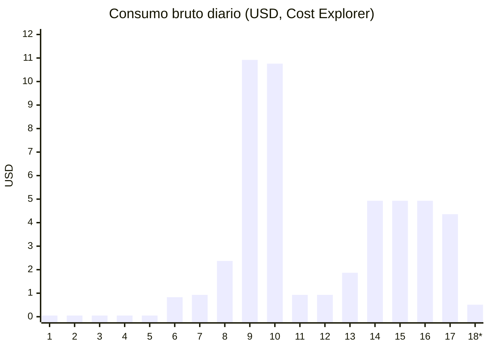

# Costos de la nube: estimados y reales (HU-26, E2.9)

Cuánto estimamos que costaría, cuánto costó de verdad según AWS y qué hicimos para controlarlo. Los números reales salen de **AWS Cost Explorer** (API `GetCostAndUsage`, 1 a 19 de noviembre de 2026) y del presupuesto `circleguard-mensual`; las cifras estimadas son las que el equipo anotó antes de encender cada cosa (decisiones D2-03, D2-12 y D2-16 del Sprint 2).

> **Aviso sobre los datos.** Cost Explorer publica con hasta 24 h de retraso: el 18 de nov aparece incompleto (USD 0,51 frente a un piso diario de 0,93) y el 19 aún no tiene datos. Todo lo que sigue está leído de la cuenta, no recordado.

## 1. Lo que costó de verdad

| Concepto (1 al 18 nov) | USD |
|---|---|
| **Consumo bruto** (uso de EC2, EBS e IPv4 público) | **49,45** |
| Créditos aplicados por AWS | −49,45 |
| Impuestos | 0,00 |
| **Neto facturado** | **0,00** |

**Dos números, dos significados.** La cuenta tiene créditos de AWS que cubren todo el consumo, así que **hasta hoy no se ha pagado nada de bolsillo**. Pero el presupuesto del equipo (`circleguard-mensual`, **USD 60**) está configurado **sin créditos** (`IncludeCredit: false`): mide el consumo bruto, que es el que seguiría costando si los créditos se acabaran. Es la cifra que usamos para decidir, porque es la conservadora. El presupuesto marca hoy USD 49,45 de 60 (82 %); su propio pronóstico (USD 101,77) extrapola linealmente los días de mayor uso y no refleja el plan de más abajo.

### Por servicio

| Servicio | USD | % | Qué es |
|---|---|---|---|
| EC2 · cómputo | 37,78 | 76 % | las máquinas encendidas: `t3.xlarge` de herramientas (149,9 h, USD 24,95) y `t3.large` de dev, stage y prod (154,2 h, USD 12,83) |
| EC2 · otros | 5,87 | 12 % | discos EBS `gp3` (USD 5,72, unos 71 GB-mes) y créditos de CPU (USD 0,15) |
| VPC | 5,81 | 12 % | **IPv4 público**: USD 4,29 por 857 h de direcciones elásticas **sin usar** (las VMs apagadas) y USD 1,52 por las que estaban en uso |

Las tarifas reales coinciden con las que estimamos: `t3.xlarge` USD 0,1664/h (24,95 / 149,9), `t3.large` USD 0,0832/h (12,83 / 154,2) y la IPv4 USD 0,005/h por dirección (4,29 / 857,5).

### Por día



\* 18 de nov: dato incompleto por el retraso de Cost Explorer.

| Días | USD/día | Qué pasaba | Lección |
|---|---|---|---|
| 1 al 5 nov | 0,05 | casi nada creado | |
| 6 al 8 nov | 0,83 a 2,37 | se creó la plataforma de la Parte 1 (Sprint 1) y se encendió por ratos | |
| **9 y 10 nov** | **10,92 y 10,76** | las **4 VMs encendidas dos días completos** (el 9 fue la sustentación de la Parte 1) | son USD 21,7: el 44 % del mes |
| 11 y 12 nov | **0,93** | todo apagado | este es el **piso**: lo que cuesta tener la nube *parada* |
| 13 nov | 1,87 | Terraform: pruebas reales de un ambiente a la vez (se crean y se destruyen) | |
| **14 al 17 nov** | **4,93 · 4,93 · 4,93 · 4,36** | la VM de **Jenkins quedó encendida 4 días** para poder fusionar un PR | USD ≈ 19; se apagó el 17 (decisión D2-16) |
| 18 nov | 0,51* | todo apagado salvo 3 ventanas cortas de Jenkins | |

**El piso de USD 0,93 al día** son los 5 discos `gp3` (170 GB, ≈ USD 0,45) y las 4 IP elásticas de la Parte 1 (4 × 0,005 × 24 = USD 0,48). Se paga aunque nada esté encendido.

## 2. Lo que estimamos

| Escenario | Estimación | Dónde se decidió |
|---|---|---|
| Los 4 ambientes encendidos a la vez (3 nodos de ambiente + herramientas) | ≈ **USD 0,50/h** (4 × `t3`) | D2-03 |
| Solo Jenkins/herramientas (`t3.xlarge`) | ≈ USD 0,17/h | D2-16 |
| Prueba real de Terraform (HU-14): los 4 ambientes ~30 min | USD 0,25 a 0,35 | D2-12 |
| **Haberlo hecho con EKS** (3 clusters) | solo el plano de control: USD 0,10/h × 3 = **USD 0,30/h ≈ USD 216/mes**, el 60 % del costo de todo lo demás | D2-03 |
| Si dejáramos la Parte 2 encendida 24×7 | `t3.large` ×2 + `t3.xlarge` ×2 = **USD 0,50/h ≈ USD 12/día ≈ USD 360/mes** | cálculo con las tarifas reales |

El estimado fue acertado en las tarifas; lo que falló fue el **comportamiento**: dos veces dejamos máquinas prendidas (9 y 10 de nov; 13 a 17 de nov) y eso explica **USD 41 de los 49** del mes.

## 3. Lo que hicimos para controlarlo (FinOps)

1. **Presupuesto con alertas** (`circleguard-mensual`, USD 60, avisos por correo). Es una *alerta*, no un tope: no apaga nada solo.
2. **Regla «nunca prendido»** (18 nov): todo encendido ocurre dentro de una **ventana corta y planeada**, se apaga en la misma sesión y se verifica con `DescribeInstances` que todo quedó `stopped`. La ventana de Jenkins del 18 nov duró **11,6 min ≈ USD 0,03**.
3. **Validar en local primero:** el cluster de Kubernetes, Sealed Secrets, TLS y el pipeline se probaron en un k3s local y en un Jenkins simulado (USD 0). La nube se usa solo para lo que no se puede probar fuera.
4. **k3s en vez de EKS** (USD 216/mes de ahorro) y **sin NAT Gateway** (≈ USD 32/mes cada uno): seguridad por grupos de seguridad.
5. **Un ambiente a la vez** en las pruebas de Terraform (también por el límite de 5 IP elásticas de la cuenta).
6. **ECR con tags inmutables y limpieza de imágenes viejas**; S3 de estado y tabla de bloqueo cuestan centavos.
7. **`terraform destroy` al terminar** cada ventana y al final de la evaluación.

## 4. Proyección hasta el 30 de nov

Supuestos: el piso es USD 0,93/día; el consumo bruto al cierre del 18 es ≈ USD 50 (49,45 más lo que falta publicar); una ventana de nube de un ambiente + Jenkins de unas 2 h cuesta ≈ USD 0,6; la demo del lunes 23 con los 4 ambientes 2 h, ≈ USD 1,0.

| Escenario | Cálculo | Total del mes |
|---|---|---|
| **A.** dejar las VMs, discos e IP de la Parte 1 hasta fin de mes | 50 + 12 días × 0,93 + ventanas ≈ 2 | **≈ USD 63**, *supera* el presupuesto en ≈ 3 |
| **B.** destruir las VMs de Bash y soltar sus IP y discos después de la evaluación (24 nov) | 50 + 5 días × 0,93 + ventanas ≈ 2 | **≈ USD 57**, dentro del presupuesto |

**Recomendación:** escenario B. Las IP y las VMs de la Parte 1 se conservan solo mientras la Parte 1 esté en revisión; destruirlas es la acción pendiente del «cutover» de Terraform y necesita la confirmación del equipo (la IP elástica es la URL entregada en el informe de la Parte 1).

> **Actualización del 22 de nov:** el consumo bruto del 1 al 22 de nov es de USD 53,56 (89 % del presupuesto; pronóstico USD 61,28). El análisis de apagado automático, Spot y el script de control están en [`docs/bonos/finops.md`](../bonos/finops.md).

## 5. Cómo se consulta

```bash
# presupuesto y consumo del mes
aws budgets describe-budget --account-id <cuenta> --budget-name circleguard-mensual
# consumo diario por servicio (los créditos aparecen aparte: RECORD_TYPE = Credit)
aws ce get-cost-and-usage --time-period Start=2026-11-01,End=2026-11-20 --granularity DAILY \
  --metrics UnblendedCost --group-by Type=DIMENSION,Key=SERVICE \
  --filter '{"Dimensions":{"Key":"RECORD_TYPE","Values":["Usage"]}}'
```

Cada llamada a la API de Cost Explorer cuesta USD 0,01. La captura de la consola de Cost Explorer (que pide el criterio de la rúbrica) se toma con la sesión del equipo; los datos de arriba son los mismos que muestra esa pantalla.
